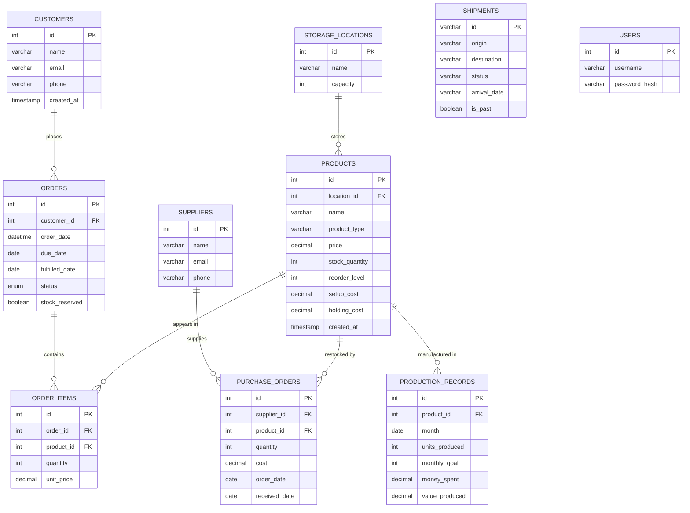

# Kelvic-the-Artist-Webpage
Web page for BFB 321
Project Title and  Description:
Kelvic The Artist Websolution
An enterprise system for small independant artists without business background and no money for large ERP systems like SAP. We are using the small artist Kelvic the artist as a base to make this web solution.


| Group names |  student numbers|
|-------------|----------------|
|Siviwe Vilane | u24693180 |
|Kelley Thlamo | u24963357 |
|Snethemba Ndlovu | u24990150 |
|Kelebone Kgalaeng | u16068221 |


## Features
| Page |  What it does |
|-------------|----------------|
| overview/ | The Web solution woks as an ERP system as in connects the business operations to one database. It has modules such as production, logistics, orders, orders and storage. |
| /login | The login page aunthenticates if the user is the admin meant to access the web solution, it uses mySQL tables. |
| /index | The welcome page. Summarises data shown in each and every page and provides current status. |
| /production | Tracks the artists studio operations. It uses the database to show data such as monthly goals and cost efficiency |
| /logistics | The shipping manager. Uses EOQ and EPQ to provide insights to the user. |
| /orders | Handles demand and fulfilment. Shows historic demand and fulfilment and also takes new orders. |
| /orders/<id> | It allows the user to see a more detailed view of the individual order. |
| /storage | The storage of the business. Uses the EPQ/EOQ formulas to show the status of an SKU. |
| / |  |

All pages use the same data base and all the tables and KPI's are updated by calculated values from the database.

## Tech stack

| Stack name |  | |
|-------------|-------------|------------|
| Python & flask| Werkzeug Security | Jinja 2  |
| MySQL | PyMySQL | Aiven | 
| HTML 5 | CSS | Javascript | 
| Git/GitHub |  |  | 

## Project structure
```text
├── app.py              # Flask routes, API endpoints, and error handling
├── models.py           # SQL queries, business logic, and supply chain math
├── db.py               # MySQL connection pool and query helpers
├── init_db.py          # Script to create tables and load seed data
├── schema.sql          # CREATE TABLE statements
├── seed.sql            # Sample data for demo
├── requirements.txt    # Python package dependencies
├── .env.example        # Template for environment variables
├── templates/          # Jinja2 HTML templates
├── static/css/         # Stylesheets
```
## Data Structure

### ERD



### Schema Details

**`storage_locations`**: Physical locations where stock is kept (Home, Commercial storage, Painting Studio).
| Column | Type | Rules |
|---|---|---|
| id | INT | primary key, auto increment |
| name | VARCHAR(80) | required, unique |
| capacity | INT | required, `CHECK (capacity > 0)` |

**`products`**: What the business sells (paintings, canvases, frames).
| Column | Type | Rules |
|---|---|---|
| id | INT | primary key, auto increment |
| location_id | INT | required, foreign key → `storage_locations.id` |
| name | VARCHAR(120) | required |
| product_type | VARCHAR(20) | required, `CHECK` (Painting, Canvas, Frame) |
| price | DECIMAL(10,2) | required, `CHECK (price >= 0)` |
| stock_quantity | INT | default 0, `CHECK (stock_quantity >= 0)` |
| reorder_level | INT | default 10, `CHECK (reorder_level >= 0)` |
| setup_cost | DECIMAL(10,2) | default 50.00 (used for EOQ calculations) |
| holding_cost | DECIMAL(10,2) | default 5.00 (used for EOQ calculations) |
| created_at | TIMESTAMP | defaults to current time |

**`customers`**: Who buys from the business.
| Column | Type | Rules |
|---|---|---|
| id | INT | primary key, auto increment |
| name | VARCHAR(120) | required |
| email | VARCHAR(160) | required, unique |
| phone | VARCHAR(30) | optional |
| created_at | TIMESTAMP | defaults to current time |

**`orders`**: Customer orders (the header record). 
| Column | Type | Rules |
|---|---|---|
| id | INT | primary key, auto increment |
| customer_id | INT | required, foreign key → `customers.id` |
| order_date | DATETIME | defaults to current time |
| due_date | DATE | optional |
| fulfilled_date | DATE | optional |
| status | ENUM | 'Open', 'Fulfilled', 'Backordered', 'Cancelled' |
| stock_reserved | BOOLEAN | flags if inventory has been deducted for this order |

**`order_items`**: The line items inside an order.
| Column | Type | Rules |
|---|---|---|
| id | INT | primary key, auto increment |
| order_id | INT | required, foreign key → `orders.id` |
| product_id | INT | required, foreign key → `products.id` |
| quantity | INT | required, `CHECK (quantity > 0)` |
| unit_price | DECIMAL(10,2) | copies price at time of order |

**`suppliers`**: Who the business buys raw materials from.
| Column | Type | Rules |
|---|---|---|
| id | INT | primary key, auto increment |
| name | VARCHAR(120) | required |
| email | VARCHAR(160) | optional |
| phone | VARCHAR(30) | optional |

**`purchase_orders`**: Restocking history from suppliers.
| Column | Type | Rules |
|---|---|---|
| id | INT | primary key, auto increment |
| supplier_id | INT | required, foreign key → `suppliers.id` |
| product_id | INT | required, foreign key → `products.id` |
| quantity | INT | required, `CHECK (quantity > 0)` |
| cost | DECIMAL(10,2) | required, `CHECK (cost >= 0)` |
| order_date | DATE | required |
| received_date | DATE | optional (NULL until delivered) |

**`production_records`**: Monthly manufacturing data (used for efficiency/EPQ).
| Column | Type | Rules |
|---|---|---|
| id | INT | primary key, auto increment |
| product_id | INT | required, foreign key → `products.id` |
| month | DATE | stored as 1st of month (e.g., 2026-10-01) |
| units_produced | INT | default 0 |
| monthly_goal | INT | default 0 |
| money_spent | DECIMAL(10,2)| default 0 |
| value_produced | DECIMAL(10,2)| default 0 |

**`shipments`**: Outbound freight tracking for the Logistics page.
| Column | Type | Rules |
|---|---|---|
| id | VARCHAR(50) | primary key (e.g., "SHP-24908") |
| origin | VARCHAR(120) | required |
| destination | VARCHAR(120) | required |
| status | VARCHAR(50) | required |
| arrival_date | VARCHAR(50) | required (formatted string) |
| is_past | BOOLEAN | flags if the shipment is in history |

**`users`**: System access accounts for management.
| Column | Type | Rules |
|---|---|---|
| id | INT | primary key, auto increment |
| username | VARCHAR(50) | required, unique |
| password_hash | VARCHAR(255)| required (Werkzeug PBKDF2 hash) |

Installation and setup instructions:
1. Install Python and git on your device: https://git-scm.com/
2. Clone the repository:

   git clone [https://github.com/u24963357-lgtm/Kelvic-the-Artist-Webpage]
   cd Kelvic-the-Artist-Webpage

3. Configure the database connection values in a local `.env` file. Start from the example:
   - On first setup only, if `.env` does not already exist: `Copy-Item .env.example .env`
   - Edit `.env` and set `DB_HOST`, `DB_PORT`, `DB_USER`, `DB_PASSWORD`, and `DB_NAME`. Set a long, random `FLASK_SECRET_KEY`; do not commit `.env`.

   In the repository terminal, run:
   - `python -m venv venv`
   - `.\venv\Scripts\Activate.ps1`
   - `pip install -r requirements.txt`
   - `python -c "from db import connect; c = connect(); c.close(); print('Database connection OK')"` to verify the connection
   - `python init_db.py` to create/update the tables and load sample data when the database is empty
   - `python app.py`

4. Open your browser and go to http://127.0.0.1:5000/

5. Log in information:
       username :adminA  password : Kelvic_2026A
       username :adminB  password : Kelvic_2026B
